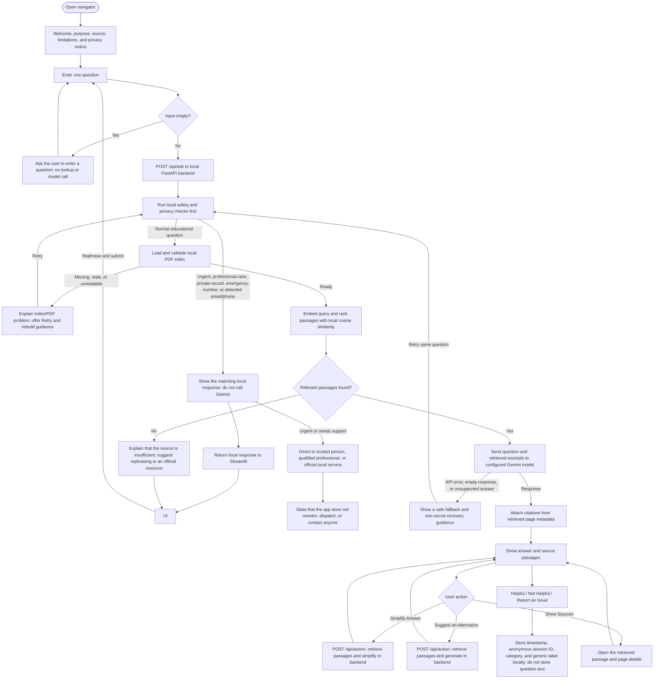

# Week 5 Conversation Flow

This flow describes the implemented Streamlit + FastAPI behavior. Streamlit sends requests to a local Python API; the API performs safety checks before index access and model calls. It is a single-question navigator, not a persistent chat transcript. Relevant implementation: [app.py](../app.py), [api.py](../api.py), [src/backend_service.py](../src/backend_service.py), and [src/safety.py](../src/safety.py).

## Behavior and boundaries

- Safety checks run before index access, embeddings, retrieval, and answer generation. Safety-routed messages are handled locally.
- Streamlit calls the local API for questions and answer-control actions. It does not call Gemini directly.
- The privacy route covers private-record requests and obvious email/phone patterns. This is not a comprehensive detector for names, addresses, or all personal information; the input notice still asks users not to share identifying or sensitive details.
- Empty retrieval has a source-limited fallback. The user can rephrase and submit again; the app does not claim that repeating the same query will create new evidence.
- API, retrieval, PDF, embedding, and Gemini failures produce a safe explanation and a Retry action. Retrieval errors also direct the user to rebuild the index when appropriate.
- Show Sources toggles the retrieved evidence panel. Simplify and Alternative reuse the existing answer-generation functions and retain citations from retrieved metadata.
- Human handover is guidance only. The app does not transfer a conversation, contact a person, dispatch services, or monitor the user.
- Feedback is local and question-free. The local delete control remains available.
