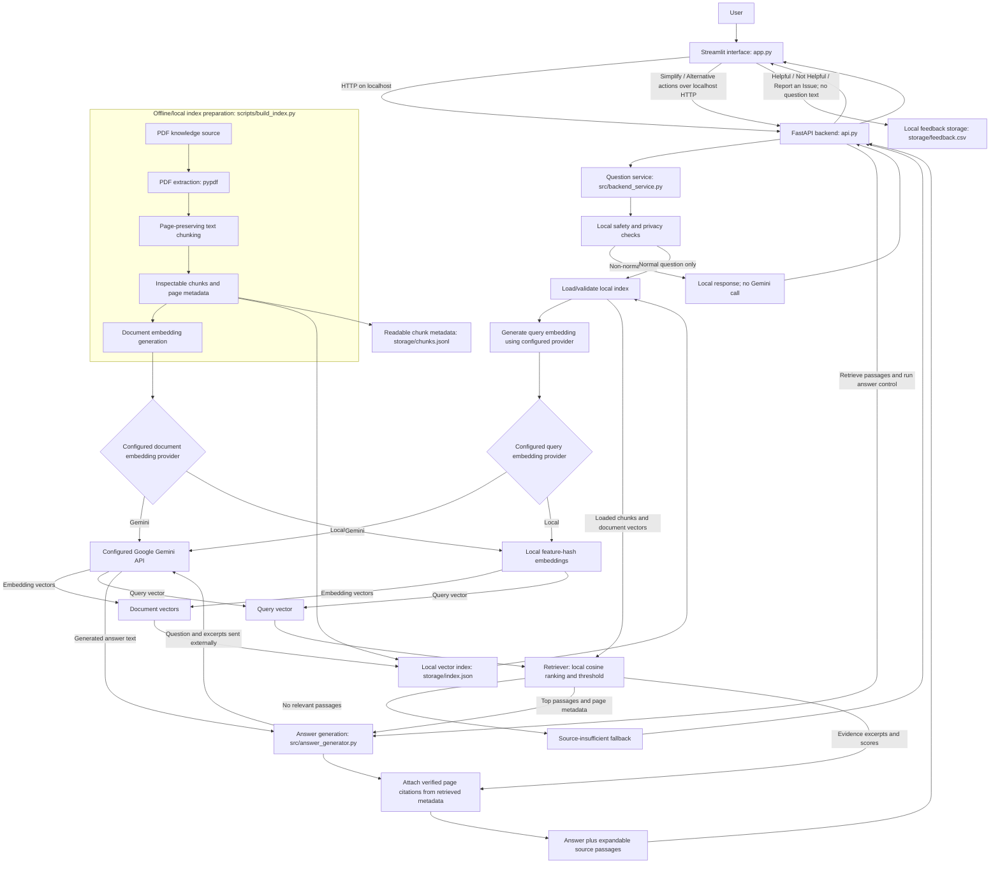

# System Architecture

This diagram follows the current Streamlit + FastAPI implementation. The key design feature is **EXPLAINABILITY AND SOURCE-GROUNDED ANSWERS**: generated answers use retrieved excerpts, and the backend adds citations from the actual retrieved page metadata.

## Data-flow notes

- PDF extraction, chunking, persisted chunks/index, and cosine ranking run locally.
- With the default Gemini provider, document chunks are sent to Gemini while building embeddings, and a normal user question is sent for its query embedding. For a generated answer, the question and retrieved excerpts are also sent to Gemini.
- The local feature-hash embedding provider avoids those embedding calls, but answer generation still requires Gemini when a supported answer is requested.
- Safety and privacy routes are evaluated before the retrieval and Gemini paths. They return local messages.
- Streamlit sends question and answer-control requests to the local FastAPI service; it does not call Gemini directly. The API validates request lengths and returns structured answer, source, route, or safe error data.
- The API binds to `127.0.0.1` by default. It is a local development backend and has no authentication; it must not be exposed publicly without additional safeguards.
- Citation text is attached by Python from retrieved page metadata. This confirms citation provenance, not that every generated claim is factually supported by the passage; human review is still needed.
- Feedback records contain a timestamp, anonymous session identifier, category, and generic technical label. They do not contain the question text.

Implementation references: [app.py](../app.py), [api.py](../api.py), [src/backend_client.py](../src/backend_client.py), [src/backend_service.py](../src/backend_service.py), [src/answer_generator.py](../src/answer_generator.py), [src/embeddings.py](../src/embeddings.py), [src/retriever.py](../src/retriever.py), [src/pdf_processor.py](../src/pdf_processor.py), [src/chunking.py](../src/chunking.py), [src/feedback.py](../src/feedback.py), and [scripts/build_index.py](../scripts/build_index.py).
